<picture><source media="(prefers-color-scheme: dark)" srcset="./assets/header-dark.svg"/><source media="(prefers-color-scheme: light)" srcset="./assets/header-light.svg"/></picture>

  <a href="mailto:adam.hassen941@gmail.com"><picture><source media="(prefers-color-scheme: dark)" srcset="./assets/btn-mail-dark.svg"/><source media="(prefers-color-scheme: light)" srcset="./assets/btn-mail-light.svg"/></picture></a>&nbsp;
  <a href="https://www.linkedin.com/in/adam-hassen-06922b170/"><picture><source media="(prefers-color-scheme: dark)" srcset="./assets/btn-linkedin-dark.svg"/><source media="(prefers-color-scheme: light)" srcset="./assets/btn-linkedin-light.svg"/></picture></a>&nbsp;
  <a href="https://huggingface.co/adam5858"><picture><source media="(prefers-color-scheme: dark)" srcset="./assets/btn-hf-dark.svg"/><source media="(prefers-color-scheme: light)" srcset="./assets/btn-hf-light.svg"/></picture></a>

 

Élève ingénieur en dernière année d'un double diplôme, **Data Science** à ESPRIT et **Interaction Personnes-Systèmes** à l'ENSIM. Je travaille sur toute la chaîne de la donnée, de la collecte à la mise en production de modèles, avec le souci de rendre ces modèles utilisables par les personnes qui en ont besoin.

Je cherche un **stage de fin d'études de 6 mois en Data Science, Machine Learning ou NLP**, à partir de **mars 2027**, en France ou au Canada.

 

## Parcours

<picture><source media="(prefers-color-scheme: dark)" srcset="./assets/parcours-dark.svg"/><source media="(prefers-color-scheme: light)" srcset="./assets/parcours-light.svg"/></picture>

 

## Projets

  <a href="https://github.com/adam-hassen/assuria-projet"><picture><source media="(prefers-color-scheme: dark)" srcset="./assets/projet-assuria-dark.svg"/><source media="(prefers-color-scheme: light)" srcset="./assets/projet-assuria-light.svg"/></picture></a>
  <a href="https://github.com/adam-hassen/stock-auto-update"><picture><source media="(prefers-color-scheme: dark)" srcset="./assets/projet-stock-dark.svg"/><source media="(prefers-color-scheme: light)" srcset="./assets/projet-stock-light.svg"/></picture></a>

  <a href="https://github.com/adam-hassen/EEG"><picture><source media="(prefers-color-scheme: dark)" srcset="./assets/projet-eeg-dark.svg"/><source media="(prefers-color-scheme: light)" srcset="./assets/projet-eeg-light.svg"/></picture></a>
  <a href="https://github.com/adam-hassen/neuron-forge"><picture><source media="(prefers-color-scheme: dark)" srcset="./assets/projet-neuron-dark.svg"/><source media="(prefers-color-scheme: light)" srcset="./assets/projet-neuron-light.svg"/></picture></a>

  <a href="https://github.com/adam-hassen/Projet_AR"><picture><source media="(prefers-color-scheme: dark)" srcset="./assets/projet-ar-dark.svg"/><source media="(prefers-color-scheme: light)" srcset="./assets/projet-ar-light.svg"/></picture></a>
  <a href="https://github.com/adam-hassen/Mobile"><picture><source media="(prefers-color-scheme: dark)" srcset="./assets/projet-budget-dark.svg"/><source media="(prefers-color-scheme: light)" srcset="./assets/projet-budget-light.svg"/></picture></a>

<b>Autres projets</b>

 

| Projet | Description | Technologies |
| :-- | :-- | :-- |
| [AssurIA, données](https://github.com/adam-hassen/assuria-donnees) | Collecte automatique des jeux de données européens du projet AssurIA | Python, ETL |
| [Back-office d'édition](https://github.com/adam-hassen/travail) | Planification de publication de séries de livres, [démo en ligne](https://travail-two.vercel.app) | Next.js, TypeScript, PostgreSQL |
| [Gestion clients et commandes](https://github.com/adam-hassen/Projet_DevOps) | Application web avec facturation, conteneurisée et en intégration continue | Flask, MySQL, Docker, CI/CD |
| [EcoGardien](https://github.com/adam-hassen/java-Mad-Lions) | Application desktop de gestion écologique, projet intégré en équipe | Java, JavaFX, MySQL |
| [Chatbot Telegram](https://github.com/adam-hassen/Chatbot_Telegram_Interop-rabilit-) | Chatbot connecté à plusieurs APIs avec une IA conversationnelle | Node.js, Express, Llama 3.3 |

 

## Compétences

<table>
  <tr>
    <td width="170"><b>Data et IA</b></td>
    <td> Pandas, NumPy, Transformers, NLP, RAG, séries temporelles, Power BI</td>
  </tr>
  <tr>
    <td><b>Développement</b></td>
    <td></td>
  </tr>
  <tr>
    <td><b>Données et MLOps</b></td>
    <td> SQL, PL/SQL, CI/CD, Scrum</td>
  </tr>
  <tr>
    <td><b>3D et XR</b></td>
    <td></td>
  </tr>
</table>

 

## Activité

<picture><source media="(prefers-color-scheme: dark)" srcset="https://raw.githubusercontent.com/adam-hassen/adam-hassen/stats/activite-dark.svg"/><source media="(prefers-color-scheme: light)" srcset="https://raw.githubusercontent.com/adam-hassen/adam-hassen/stats/activite-light.svg"/></picture>
