Élève ingénieur en dernière année d'un double diplôme : **Data Science** à ESPRIT (Tunis) et **Interaction Personnes-Systèmes** à l'ENSIM, Le Mans Université. Je travaille sur toute la chaîne de la donnée, de la collecte à la mise en production de modèles, et je m'intéresse autant aux modèles qu'aux interfaces qui les rendent utiles.

**Je cherche un stage de fin d'études de 6 mois en Data Science, Machine Learning ou NLP, à partir de mars 2027**, en France ou au Canada.

 

## Expérience

**Associé technique, LinqCe** &nbsp;·&nbsp; 2025–2026 
Cofondation d'une plateforme de mise en relation entre indépendants, entreprises, associations et administrations. Intégration de l'IA et développement full-stack.

**Stage ingénieur, Vermeg** (département Assurance) &nbsp;·&nbsp; 2024–2025 
Tableau de bord de surveillance des logs en temps réel, classification automatique des erreurs et modèle prédictif pour anticiper les incidents et en identifier les causes probables.

**Stage, Aman Bank** &nbsp;·&nbsp; 2023–2024 
Application web bancaire en Angular et Node.js : authentification, modules, consultation des chèques et des effets.

 

## Projets

| Projet | Description | Technologies |
| :-- | :-- | :-- |
| [**AssurIA**](https://github.com/adam-hassen/assuria-projet) | Services d'assurance intelligents : personnalisation des offres avec un petit LLM fine-tuné, conseiller RAG pour l'analyse de contrats, prédiction du coût des sinistres. Projet de recherche appliquée, en cours. | Python, LLM, RAG, ML, PostgreSQL |
| [**AssurIA, données**](https://github.com/adam-hassen/assuria-donnees) | Collecte automatique des jeux de données européens du projet (sinistres, offres, simulation de prix). | Python, ETL |
| [**Stock Auto Update**](https://github.com/adam-hassen/stock-auto-update) | Pipeline automatisé de collecte de données boursières et d'analyse de sentiment financier, publié en dataset sur Hugging Face. | Python, FinBERT, GitHub Actions |
| [**Charge cognitive EEG**](https://github.com/adam-hassen/EEG) | Estimation de la charge cognitive d'un conducteur à partir de signaux EEG (dataset CL-Drive). | Python, traitement du signal, ML |
| [**Neuron Forge**](https://github.com/adam-hassen/neuron-forge) | Jeu pédagogique en vue subjective où l'on construit, entraîne et valide un réseau de neurones. | C++, Unreal Engine 5 |
| [**AR-Secours**](https://github.com/adam-hassen/Projet_AR) | Application Android de réalité augmentée pour apprendre les gestes de premiers secours. | C#, Unity, AR Foundation |
| [**MonBudget**](https://github.com/adam-hassen/Mobile) | Application Android de gestion de budget pour étudiants. | Kotlin, Jetpack Compose, Room |
| [**Back-office d'édition**](https://github.com/adam-hassen/travail) | Gestion et planification de publication de séries de livres. [Démo](https://travail-two.vercel.app) | Next.js, TypeScript, PostgreSQL |
| [**Gestion clients et commandes**](https://github.com/adam-hassen/Projet_DevOps) | Application web CRUD avec facturation, conteneurisée et testée en intégration continue. | Flask, MySQL, Docker, CI/CD |
| [**EcoGardien**](https://github.com/adam-hassen/java-Mad-Lions) | Application desktop de gestion écologique, projet intégré en équipe. | Java, JavaFX, MySQL |
| [**Chatbot Telegram**](https://github.com/adam-hassen/Chatbot_Telegram_Interop-rabilit-) | Chatbot connecté à plusieurs APIs, avec une IA conversationnelle (Llama 3.3 70B). | Node.js, Express |

 

## Compétences

**Data et IA** : Python, Pandas, NumPy, scikit-learn, TensorFlow, PyTorch, Transformers, NLP, RAG, séries temporelles, Power BI 
**Développement** : Java, C, C++, C#, .NET, Symfony, Angular, Node.js, Next.js, Kotlin 
**Données et MLOps** : SQL, PL/SQL, PostgreSQL, Docker, GitHub Actions, Git, Scrum

  

 

## Formation

**ENSIM, Le Mans Université** &nbsp;·&nbsp; 2025–2027 
Cycle ingénieur en informatique, spécialité Interaction Personnes-Systèmes : UX/UI, DevOps, développement mobile, visualisation, réalité augmentée, machine learning avancé.

**ESPRIT, Tunis** &nbsp;·&nbsp; 2021–2026 
Cycle ingénieur en informatique, spécialité Data Science : statistiques, séries temporelles, Big Data, machine learning et deep learning.

**Langues** : français courant, anglais professionnel, arabe langue maternelle.

 

## Activité

  
  &nbsp;
  

